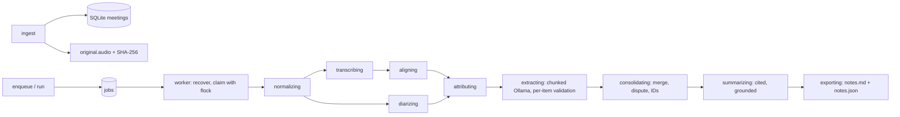

# Architecture — Phases 1 and 2

A local CLI over a durable SQLite job queue. No web service yet (Phase 3). `cli` loads
validated TOML configuration and enables runtime privacy controls before any ML imports.
Design decisions: [ADR-0001](decisions/0001-phase1-extractive-drafts.md),
[ADR-0002](decisions/0002-phase2-evidence-and-durable-jobs.md).

## Modules

- `ingestion`: content signatures plus ffprobe, bounded copy, SHA-256, random UUID paths,
  UTF-8 attachments. Deduplicates on (audio hash, attachment hash) in SQLite. Writes an
  immutable `meeting.json` import record, then registers the meeting; `adopt` registers a
  verified directory whose registration was interrupted (or a Phase 1 directory).
- `audio`: ffmpeg/ffprobe argument arrays, no shell, file/pipe protocols only, time,
  size and duration limits, metadata stripping on normalization.
- `transcription`: WhisperX 3.8.6, local CTranslate2 directory, Silero JIT VAD from the
  installed wheel. Bounded 10-minute windows; batch halving on GPU OOM; cancellation checked
  between windows.
- `alignment`: local CTC model per segment; missing word timings stay null. Alignment scores
  are never speaker confidence. `alignment.speakers` maps diarization labels by first
  appearance; multiple candidates give `Uncertain`, no coverage `Unknown`.
- `diarization`: local Community-1, regular output (overlaps retained). On GPU OOM, halves
  pyannote batch sizes down to 1, then optionally (`oom_cpu_fallback`) retries on CPU.
- `extraction`: Stage 1. `evidence` builds byte-bounded chunks with stable segment IDs and
  `chunk_overlap_segments` repeated segments, calls Ollama with the `ExtractionResult` JSON
  schema, validates with Pydantic, then validates each item against its chunk (`grounding`).
  `consolidate` merges duplicates across chunks and restatements, keeps distinct commitments,
  marks conflicting classifications disputed, and assigns ordered IDs `i0001…`.
- `notes`: Stage 2 `summary` (cited points from evidence only, grounded and checked for
  decision language) and deterministic `render` for Markdown/JSON.
- `speakers.mapping`: user-confirmed names and per-segment corrections for one meeting,
  bound to the attributed transcript's hash. Applied at render time only. A future
  consent-based enrollment would add its own tables; nothing infers identity.
- `jobs.queue`: enqueue (idempotent per meeting), claim, execute, cancel, recover, describe.
- `pipeline`: checkpointed stage executor and `export_notes`.
- `storage`: private directories and atomic fsync/rename artifacts (`files`), advisory
  flock (`locking`), SQLite connection and migrations (`db`, `migrations`).

## SQLite

`data/notes.sqlite3`, mode 0600, WAL, `synchronous=FULL`, foreign keys on,
`trusted_schema=OFF`, STRICT tables, forward-only migrations (`PRAGMA user_version`).

| Table | Holds |
| --- | --- |
| meetings | ID, audio/attachment hashes, duration, container, import time, user title/date |
| jobs | kind (full/notes), mode, force, state, current stage, attempts, cancel flag, safe error |
| stage_runs | per-job stage outcome (succeeded/skipped/failed/cancelled/interrupted), seconds, counts |
| checkpoints | per-meeting stage fingerprint and artifact SHA-256 map |
| segments | segment ID, order, start/end, attributed speaker, overlap (no text) |
| extraction_chunks | schema-valid raw Stage 1 responses keyed by prompt/model/payload hash |
| items, item_evidence | consolidated evidence items and their verbatim quotes |
| speaker_names, speaker_corrections | confirmed names / segment reassignments per transcript hash |

Transcript text lives in artifacts; quotes in `items`/`item_evidence` and cached chunk
responses are transcript excerpts, so the database is as sensitive as the transcripts.

## Jobs, checkpoints and recovery

Job states: `queued → running → succeeded | failed | cancelled`; a crash or SIGTERM
returns a running job to `queued` (until `max_attempts`, then `failed`). One active job per
meeting (partial unique index). A worker takes the meeting's `.processing.lock` before
marking a job running and records the outcome before releasing it; `recover` requeues
running jobs whose lock is free (the holder died). Failures are not retried automatically.

Each stage records a fingerprint of its version, output-relevant settings, model identity
and input artifact hashes, plus its output hashes. A rerun reuses a stage only if both still
match; the old checkpoint is deleted before a stage recomputes. `--force` ignores checkpoints
and the chunk cache. `--notes-only` skips audio stages and requires a verified attributed
transcript. `exporting` always re-renders so title/date/speaker edits apply without models.
Cancellation is checked at stage start, between transcription windows and between LLM
chunks; a native call in progress is not interrupted.

## Artifacts

`data/<uuid>/`: `original.audio` (unchanged), optional `attached.transcript`, `meeting.json`,
`normalized.wav`, `verbatim.json`, optional `comparison.json`, `aligned.json`,
`diarization.json`, `transcript.json`, `extraction.json` (validated items + rejection
counts), `evidence.json` (consolidated items), `summary.json`, `notes.md`, `notes.json`.
All private, none committed, none deleted automatically.

## Deferred

Phase 3: loopback FastAPI dashboard/import/settings/transcript and speaker-correction UI
(the storage and CLI for corrections exist). Phase 4: SQLite FTS, optional local embeddings,
broader OS sandbox validation, measured performance work. Retention policies and deletion
are not implemented.
