# Architecture — scaffold and Phase 1

This is a synchronous local CLI, not yet a production service. `cli` loads validated
TOML configuration and enables runtime privacy controls before any ML imports.

```mermaid
flowchart LR
  A[CLI import] --> B[Validate and hash original]
  B --> C[ffmpeg mono PCM 16 kHz]
  C --> D[Local WhisperX + packaged VAD]
  D --> E[Local word alignment]
  E --> F[Local Community-1 diarization]
  F --> G[Conservative speaker attribution]
  G --> H[Local Ollama excerpt classification]
  H --> I[Validate quotes and fields]
  I --> J[Markdown + JSON]
```

## Contracts

- `ingestion`: content signatures plus ffprobe, bounded copy, SHA-256, random UUID
  paths, UTF-8 attachments. Original names never become storage paths or log fields.
- `audio`: ffmpeg/ffprobe subprocess argument arrays, no shell, local file/pipe
  protocols only, time limits, size/duration limits, metadata stripping on normalization.
- `transcription`: WhisperX 3.8.6 with local CTranslate2 directory and Silero JIT
  VAD from the explicitly installed wheel. It never uses torch.hub remote repositories.
  Audio is transcribed in bounded 10-minute windows (configurable); words at hard
  window boundaries need actual-audio evaluation. Language auto-detection is available.
- `alignment`: local language-specific Hugging Face CTC model, `local_files_only`,
  cached NLTK resources; imports aligned one timed segment at a time. Missing word
  timings remain null. Preserve raw segments/text separately. Alignment scores are
  model alignment scores, never speaker-confidence values.
- `diarization`: local Community-1 pipeline; regular speaker intervals retain overlaps.
  Whole-recording diarization keeps labels consistent; no per-window speaker renumbering.
  It can load the entire waveform and is not bounded to transcription-window RAM.
- `alignment.speakers`: maps backend labels by first appearance. Multiple candidate
  speakers produce `Uncertain`, missing coverage `Unknown`. Word labels remain available
  even when a segment contains multiple voices. No speaker identity or voiceprints.
- `notes`: one bounded schema-constrained classification call per transcript chunk;
  exact excerpt, segment ID, optional explicit owner/deadline. A deterministic renderer
  produces extractive draft notes. This is a Phase 1 safety baseline, not the planned
  richer two-stage evidence/consolidation system. Only exact repeated cited items dedupe.
- `storage`: local directories, atomic fsync/rename JSON/text artifacts. No database yet.
  SHA-256 is corruption detection, not authenticated integrity against a local attacker.

## Artifacts and state

`data/<uuid>/` contains `original.audio` (unchanged bytes), optional
`attached.transcript`, `meeting.json`, `normalized.wav`, `verbatim.json`,
`aligned.json`, `diarization.json`, `transcript.json`, `notes.json`, `notes.md`,
and optional `comparison.json`. All are private. None are committed.

States: imported → normalizing → transcribing → aligning → diarizing → notes → complete.
An exception records failed stage/error class; Ctrl-C records interrupted. No model exception
message or source text is logged. `--notes-only` reuses the attributed transcript, preserving
expensive audio stages. A full manual rerun recomputes audio stages. Abrupt termination,
power loss and concurrent writers do not yet have queue/lease/restart guarantees.

The manifest records source revision and every model artifact's SHA-256. `models-check`
and full processing verify the inventory. This can take time on large weights. Import
deduplication compares audio and attachment hashes; different attachments create different
meeting IDs. Files are never expired or automatically deleted in Phase 1.

## Deferred phases

Phase 2: SQLite schema/migrations, durable stage scheduling/restart recovery, richer
evidence validation/consolidation and human review, cancellation and retention policies.
Phase 3: loopback-only FastAPI dashboard/import/settings/transcript and speaker corrections.
Phase 4: SQLite FTS, optional local embeddings, broader OS sandbox validation and measured
performance improvements. No vector server is needed in this scaffold.
